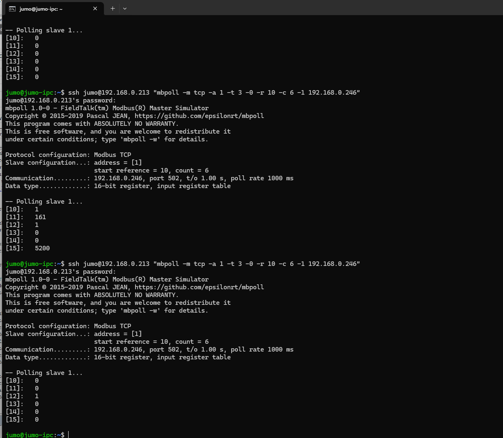
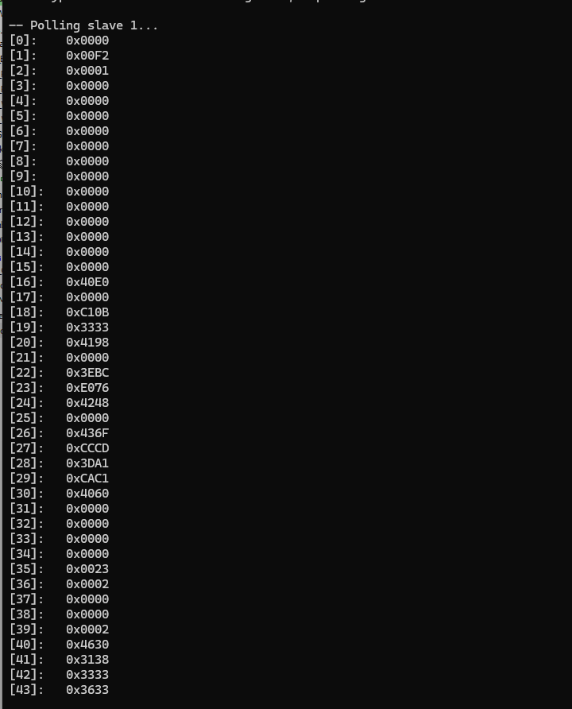
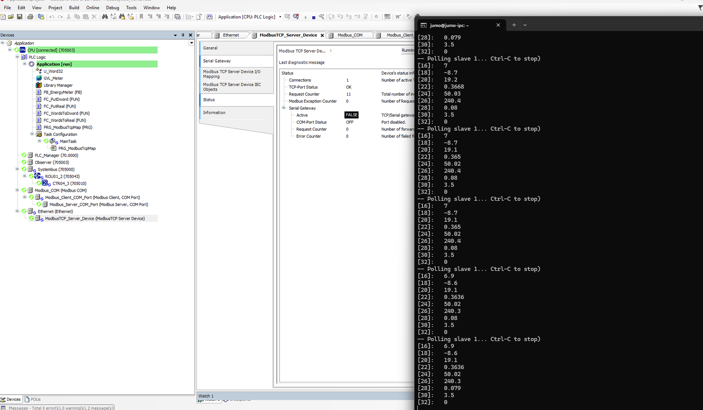

# Mapa Modbus TCP: variTRON 300 → collector (kontrakt, wersja 2)

**Wersja 2 (25.11.2026, E2-PLC2):** rejestry 44–59 (offsety bloku 34–49) zajęte przez energię bierną, THD, kąt, temperaturę i czas pracy licznika; rejestry 0–43 bez zmian. Obowiązuje w PLC od przełączenia w kroku PLC-2 (data i godzina – w tabeli okien `data_windows`). Collector obsługuje **v1 i v2 jednocześnie**.

Wersja 1: stan na 23.11.2026, etap 1. Zweryfikowane na sprzęcie: `mbpoll` z komputera `jumo-ipc` (192.168.0.213) odczytał rejestry 0–43 i wartości REAL zgodne z podglądem online w CODESYS.
Zmiana tego kontraktu = zmiana `MAP_VERSION` w PLC (rejestr 2) + nowa wersja tego dokumentu. Claude Code tego pliku nie zmienia, zgłasza potrzebę zmiany.

## Połączenie

| Parametr | Wartość |
| --- | --- |
| Serwer | JUMO variTRON 300, adres z `config/devices.yaml` (obecnie 192.168.0.246, DHCP) |
| Port / Unit ID | 502 / 1 |
| Funkcja | **04 – Read Input Registers** (jedyna używana) |
| Zakres | Input Registers 0–99, adresowanie od 0 (offset PDU) |
| Wartości 32-bitowe | **starsze słowo pierwsze** (big-endian), w słowie starszy bajt pierwszy |
| Zapytanie collectora | 0–59 (60 rejestrów) jednym zapytaniem FC04, dla v1 i v2 (na v1 rejestry 44–59 = 0; do potwierdzenia `mbpoll -c 60` przed wdrożeniem) |
| Odświeżanie danych w PLC | pomiary co 1 s, identyfikacja co 10 s; sensowny cykl collectora: 1 s |

## Zasady

- Collector **tylko czyta** (FC04). Holding registers serwera (10) są ustawione jako niezapisywalne (`Writeable` odznaczone) i nieużywane.
- **Serial Gateway serwera musi być wyłączona** (`ModbusTCP_Server_Device` → Serial Gateway → „Serial gateway active” odznaczone). Włączona przekazuje zapytania TCP na RS485 – collector nie dostaje danych z PLC i mógłby zapisywać do licznika.
- Serwer pokazuje w CODESYS „Not running” i ikonę ostrzeżenia, gdy nie ma podłączonego klienta – to normalne. Przy podłączonym kliencie: „Running”, Connections ≥ 1.

## Nagłówek

| Rejestr | Nazwa | Typ | Jednostka | Opis |
| --- | --- | --- | --- | --- |
| 0–1 | `heartbeat` | UDINT | – | +1 w każdym cyklu MainTask; przepełnienie → 0. Brak zmiany przez > 5 s = PLC nie działa / program zatrzymany |
| 2 | `map_version` | UINT | – | 1 albo 2. Collector przyjmuje 1 i 2 (przy 1 nie publikuje pól v2), każdą inną wersję odrzuca (`link_status` 3) |
| 3–9 | – | – | – | zarezerwowane (0) |

## Blok licznika 1 – Finder 7M.24, nr ser. F0183363 (baza 10)

Kolejny licznik dostanie blok od bazy 60 (blok = 50 rejestrów, offsety jak niżej).

| Rejestr | Offset w bloku | Nazwa | Typ | Jednostka | Uwagi |
| --- | --- | --- | --- | --- | --- |
| 10 | 0 | `status` | UINT | – | 0 = OK, 1 = COMM_ERROR (brak odpowiedzi / błąd Modbus RTU; powrót do 0 dopiero po 3 s bez żadnego błędu), 2 = NO_DATA (licznik nie odpowiedział od startu PLC; do ok. 10 s po starcie) |
| 11 | 1 | `error_code` | UINT | – | ostatni kod `MB_ErrorCodes` z biblioteki IoDrvModbus w trakcie błędu (161 = 16#A1 = RESPONSE_TIMEOUT); 0 gdy status OK |
| 12 | 2 | `error_count` | UINT | – | liczba przerw komunikacji (wejść w COMM_ERROR) od startu PLC; jedna przerwa = +1; przepełnienie → 0 |
| 13 | 3 | – | – | – | zarezerwowane |
| 14–15 | 4 | `data_age_ms` | UDINT | ms | 0 gdy OK; przy COMM_ERROR czas od ostatniego potwierdzonego stanu OK (rośnie równo przez całą przerwę); przy NO_DATA = 16#FFFFFFFF |
| 16–17 | 6 | `active_power` | REAL | W | Pt, znak: + pobór |
| 18–19 | 8 | `reactive_power` | REAL | var | Qt, znak: − pojemnościowa |
| 20–21 | 10 | `apparent_power` | REAL | VA | St |
| 22–23 | 12 | `power_factor` | REAL | – | PFt |
| 24–25 | 14 | `frequency` | REAL | Hz | |
| 26–27 | 16 | `voltage` | REAL | V | U1 |
| 28–29 | 18 | `current` | REAL | A | I1 |
| 30–31 | 20 | `energy_import_kwh` | REAL | kWh | n1, do podglądu; traci rozdzielczość przy dużych stanach |
| 32–33 | 22 | `energy_export_kwh` | REAL | kWh | n3, do podglądu |
| 34–35 | 24 | `energy_import_mant` | DINT | – | n1: Wh = mant × 10^exp – **do zapisu w bazie** |
| 36 | 26 | `energy_import_exp` | INT | – | obecnie 2 (rozdzielczość 100 Wh) |
| 37–38 | 27 | `energy_export_mant` | DINT | – | n3 |
| 39 | 29 | `energy_export_exp` | INT | – | |
| 40–43 | 30 | `serial` | 4 × WORD | ASCII | „F0183363”, 2 znaki na rejestr, starszy bajt pierwszy |
| 44–45 | 34 | `reactive_pos_mant` | DINT | – | **v2.** n2 (30408–30409): varh = mant × 10^exp; energia bierna przy Q > 0 |
| 46 | 36 | `reactive_pos_exp` | INT | – | **v2.** n2 (30402), obecnie 2 (rozdzielczość 100 varh) |
| 47–48 | 37 | `reactive_neg_mant` | DINT | – | **v2.** n4 (30412–30413); energia bierna przy Q < 0 |
| 49 | 39 | `reactive_neg_exp` | INT | – | **v2.** n4 (30404) |
| 50–51 | 40 | `thd_voltage` | REAL | % | **v2.** THD U1 (32594) |
| 52–53 | 42 | `thd_current` | REAL | % | **v2.** THD I1 (32588) |
| 54–55 | 44 | `phase_angle` | REAL | ° | **v2.** kąt U1–I1 (32570); ujemny przy Q < 0 (zmierzone 25.11: −50,58° przy Q ≈ −8,7 var) |
| 56–57 | 46 | `meter_temperature` | REAL | °C | **v2.** temperatura wewnętrzna licznika (32658), odświeżana w PLC co 10 s |
| 58–59 | 48 | `run_time` | REAL | s | **v2.** czas pracy licznika (32480), odświeżany w PLC co 10 s; REAL dokładny do 1 s do 2^24 s (ok. 194 dni) |

Blok licznika jest w v2 pełny (offsety 0–49). Liczniki o podwyższonej rozdzielczości (30462–30485) – etap 4, nowa wersja mapy.

**Energia bierna n2/n4 (v2):** nazwy wg znaku Q, a nie „pobrana/oddana”. Stan 23.11.2026: n2 = 0, n4 = 4,5 kvarh, a obciążenie ma stale Q < 0 – stąd n4 = energia przy Q < 0. Potwierdzenie przy pierwszym kroku n4 o 100 varh (przy Q ≈ −9 var ok. 11 h). W konwencji odbiornika Q > 0 = indukcyjna, Q < 0 = pojemnościowa.

**Kąt a współczynnik mocy:** przy THD prądu ok. 140 % PF (0,37) ≠ cos φ = cos(kąt) (0,64); PF = cos φ / √(1 + THD_I²). Zmierzone 25.11.2026 w PLC-1.

n1 = energia pobrana – ustalone 23.11.2026 na żywym liczniku (przy P > 0 rośnie n1, n3 = 0); potwierdzenie stanem kWh z wyświetlacza – patrz etap 1.

### Status komunikacji z licznikiem – zachowanie (poprawka 23.11.2026)

`Modbus_Server_COM_Port.xError` pokazuje wynik pojedynczej transakcji i między zapytaniami kanałów wraca na chwilę do FALSE. Dlatego `FB_EnergyMeter` filtruje go: COMM_ERROR od pierwszego błędu, powrót do OK po `tErrorHold` = 3 s bez błędu. Układ rejestrów bez zmian, `MAP_VERSION` = 1. Test 23.11.2026 (odłączenie przewodu RS485): status 1, kod 161, `error_count` 1, `data_age_ms` 5200; po podłączeniu status 0, `error_count` nadal 1.



## Jak collector ma oceniać ważność danych

1. Brak połączenia TCP / timeout → status urządzenia „PLC offline”, pomiary nie są zapisywane.
2. `map_version` ∉ {1, 2} → błąd konfiguracji, nie zapisujemy. Przy 1 – tylko pola v1.
3. `heartbeat` bez zmiany przez > 5 s → „PLC zatrzymany”, pomiary nie są zapisywane.
4. `status` ≠ 0 → pomiary licznika nieważne (wartości są zamrożone, „Keep last value”); zapisujemy tylko status.
5. `serial` ≠ numer z `config/devices.yaml` → błąd konfiguracji (inny licznik pod tym blokiem).

## Test z komputera (tylko odczyt)

```bash
# surowe rejestry 0–59 (v2)
mbpoll -m tcp -a 1 -t 3:hex -0 -r 0 -c 60 -1 192.168.0.246
# wartości REAL v2 50–59 (THD U, THD I, kąt, temperatura, czas pracy)
mbpoll -m tcp -a 1 -t 3:float -B -0 -r 50 -c 5 -1 192.168.0.246
# wartości REAL 16–33 (‑B = starsze słowo pierwsze)
mbpoll -m tcp -a 1 -t 3:float -B -0 -r 16 -c 9 -1 192.168.0.246
```

Wynik z 23.11.2026: P 7,0 W, Q −8,7 var, S 19,1 VA, PF 0,365, f 50,02 Hz, U 240,4 V, I 0,08 A, energia pobrana 3,5 kWh (mantysa 35, wykładnik 2), oddana 0, serial F0183363, status 0.

## Strona PLC (dla porządku)

Kod ST: `plc/src/` (`GVL_Meter.awTcpInputRegs` zmapowane na Input Registers `ModbusTCP_Server_Device`; zapis w `PRG_ModbusTcpMap`, wywoływany w MainTask).

## Tak wygląda poprawny odczyt





Więcej zrzutów i typowe błędy: [`docs/stages/etap-1.md`](stages/etap-1.md).
