# Etap 1 – PLC: licznik Finder → variTRON 300 → Modbus TCP

Stan: **zakończony 23.11.2026** (kryterium: `mbpoll` z komputera pokazuje ok. 230 V – odczytano 240,4 V). Pełny opis: `AI_Predykcja_dokumentacja.docx` v1, rozdział 4.1. Kontrakt dla collectora: [`docs/modbus-map.md`](../modbus-map.md). Kod ST: [`plc/src/`](../../plc/src/).

## Konfiguracja w skrócie

| Odcinek | Ustawienia |
| --- | --- |
| RS485 → PLC | złącze „COM” CPU = `Modbus_COM` COM port 1, 19200, 8N2; licznik pod adresem **2**; response timeout 200 ms; 6 kanałów FC04, Keep last value |
| PLC → komputer | `Ethernet` LAN1 (192.168.0.246, DHCP) → `ModbusTCP_Server_Device`, port 502, Unit ID 1, 100 Input Registers, holding niezapisywalne, **Serial Gateway wyłączona** |
| Program | `PRG_ModbusTcpMap` w MainTask → `FB_EnergyMeter` (jedna instancja na licznik) → `GVL_Meter.awTcpInputRegs` |

## Tak wygląda poprawny stan

Tabela kanałów RTU – wszystkie FC04, offsety szesnastkowo (2490 = `16#09BA`):

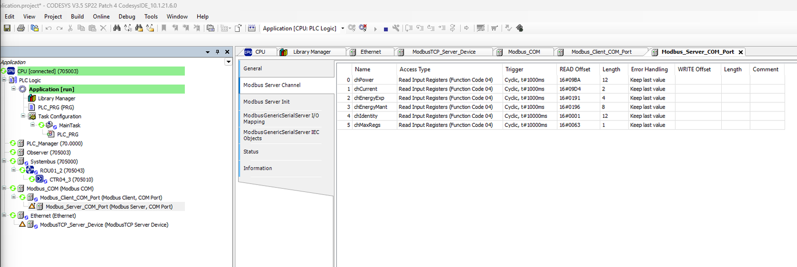

Status `Modbus_Server_COM_Port` – Running, błędy nie rosną:

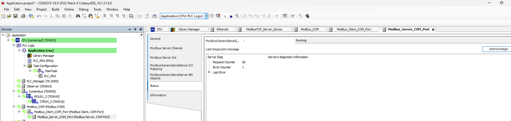

I/O Mapping (hex) – model i numer seryjny `4630 3138 3333 3633` = „F0183363”:

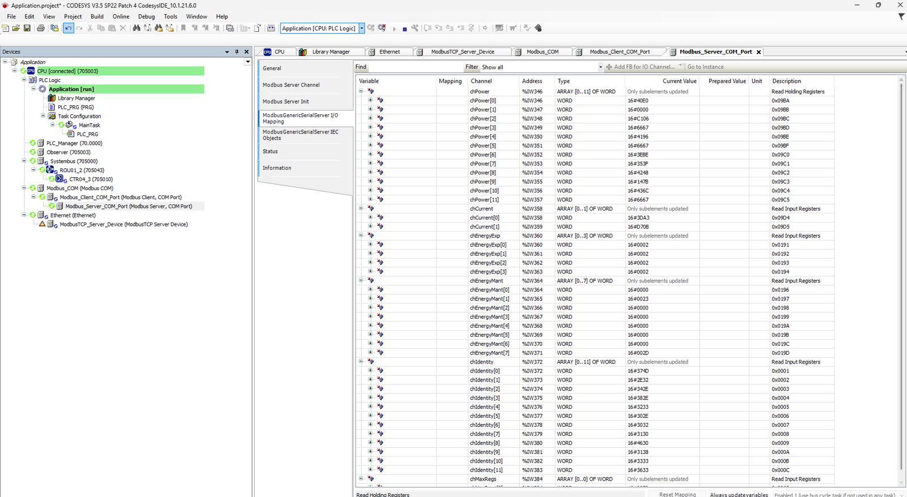

Program online – wartości w jednostkach fizycznych, status 0:

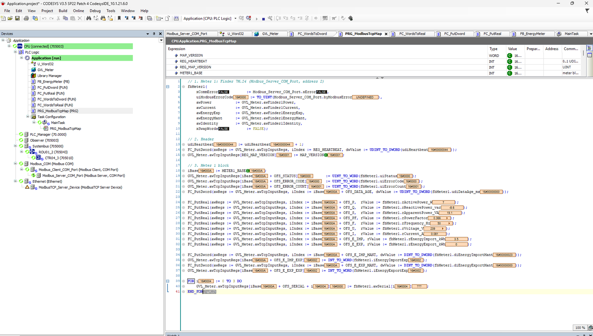

Serial Gateway wyłączona:

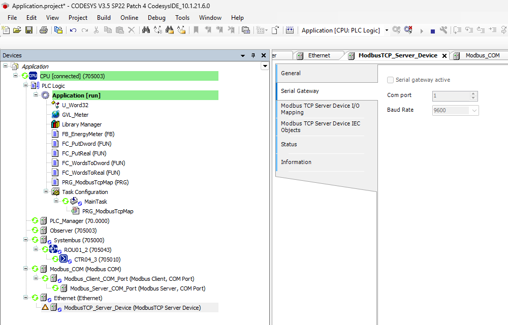

`mbpoll` z komputera (hex 0–43) oraz ciągły odczyt float przy statusie serwera Running / Connections 1:

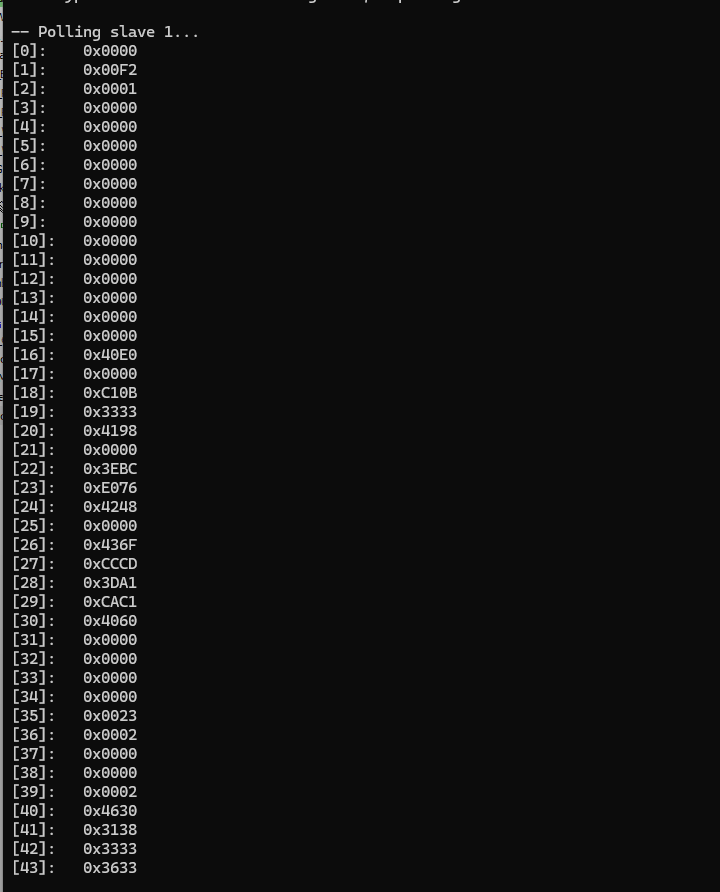

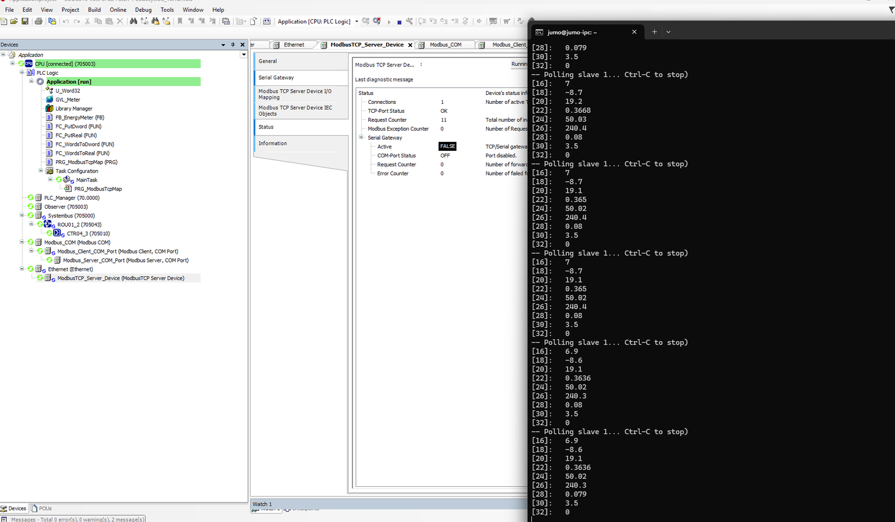

Wyświetlacz licznika do porównania – 3,5 kWh ↑ (n1), 6,9 W, 239,5 V, 0,080 A, 0,0 kWh ↓ (n3), 4,5 kvarh ↓ (n4):

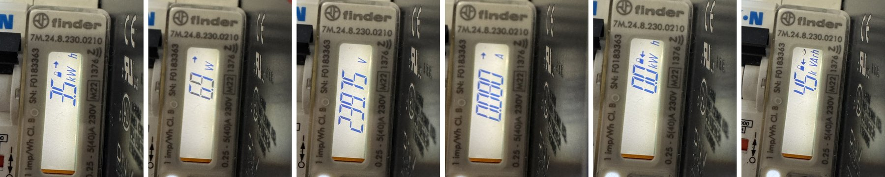

Licencje Modbus na variTRON (Web Cockpit → License management):

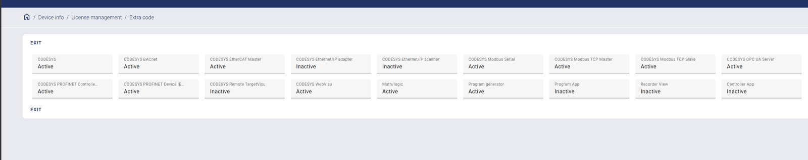

## Typowe błędy

| Objaw | Przyczyna | Rozwiązanie |
| --- | --- | --- |
| Error Counter = Request Counter, Last Error `RESPONSE TIMEOUT` | zły adres licznika (33 zamiast 2), zamienione A/B, zła prędkość | odczytać menu licznika Set → COMM (bez długiego dotyku), dopasować PLC |
| licznik zwraca wyjątek / inne dane | offset `16#2490` zamiast `16#09BA` | offset szesnastkowo |
| `mbpoll`: „Connection timed out”, `nc` łączy się z 502 | Serial Gateway włączona | wyłączyć, pełny download |
| serwer TCP „Not running” + trójkąt | brak klienta – normalne | nic |
| „The bus is not running” po zmianach | logowanie bez downloadu | Logout → Build → Login with download → Start |

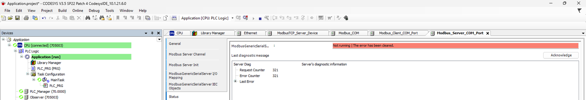

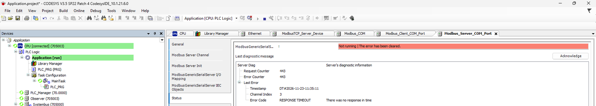

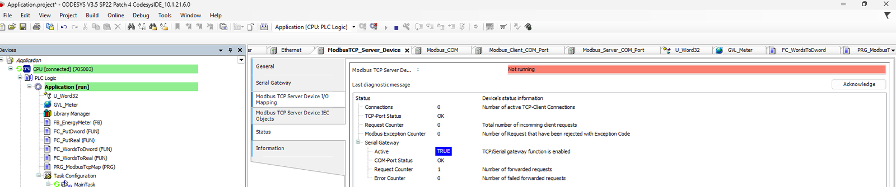

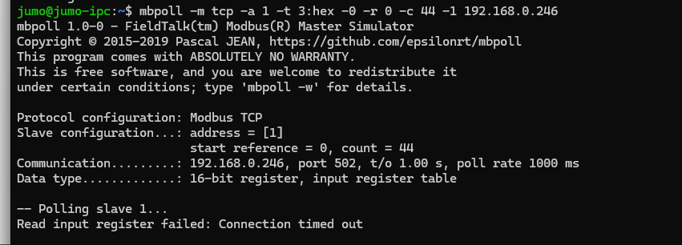

## Checklista akceptacji (Grzegorz, na sprzęcie)

Polecenia `mbpoll` z laptopa w cmd: `ssh jumo@192.168.0.213 "<polecenie>"`.

| # | Krok | Oczekiwane | Stan |
| --- | --- | --- | --- |
| 1 | CODESYS: `Modbus_Server_COM_Port` → Status przez 10 min | Running, Error Counter nie rośnie | OK |
| 2 | `mbpoll -m tcp -a 1 -t 3:hex -0 -r 0 -c 44 -1 192.168.0.246` | rej. 2 = 1, 10 = 0, 40–43 = `4630 3138 3333 3633` | OK |
| 3 | `mbpoll -m tcp -a 1 -t 3:float -B -0 -r 16 -c 9 -1 192.168.0.246` | U 220–245 V, f 49,9–50,1 Hz, P zgodne z wyświetlaczem | OK |
| 4 | dwa odczyty rejestrów 0–1 w odstępie kilku sekund | heartbeat różny | OK |
| 5 | odłączyć jeden przewód RS485 na 10 s, odczytać rej. 10–15; podłączyć | status 1, error_code ≠ 0, data_age rośnie; potem status 0 | OK |
| 6 | wyłączyć i włączyć zasilanie PLC (bez CODESYS) | po starcie `mbpoll` znów pokazuje dane | OK |
| 7 | `ModbusTCP_Server_Device` → Serial Gateway | odznaczone | OK |

## Okablowanie

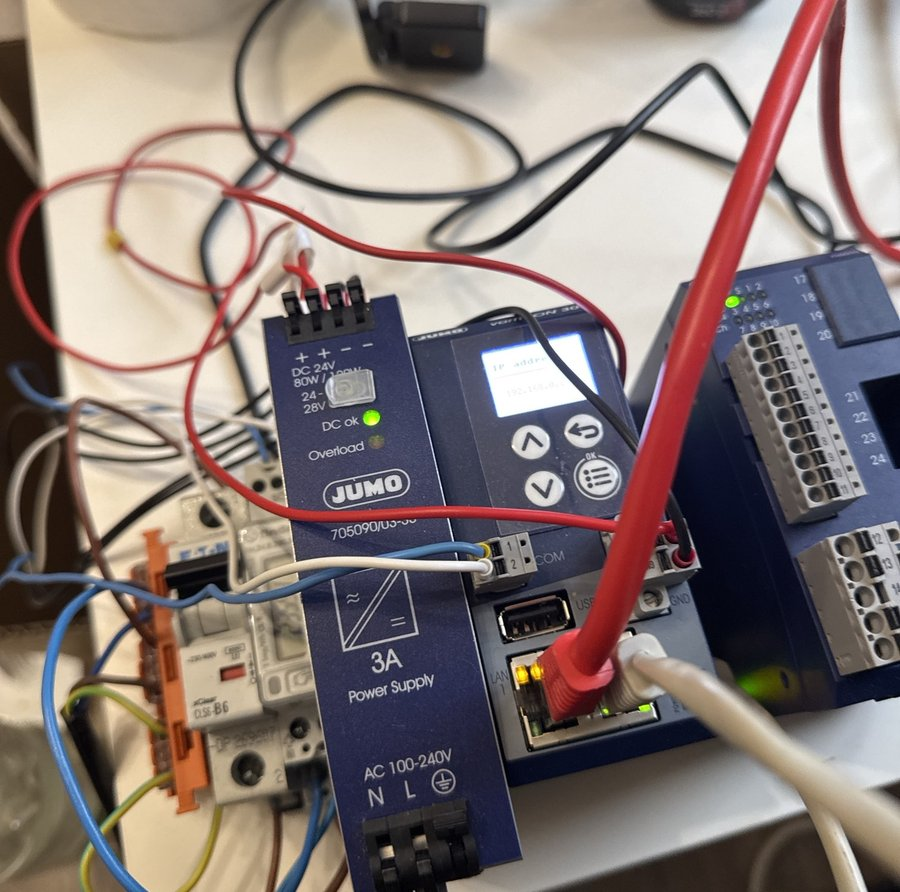

Licznik mierzy zasilanie sterownika (odłączenie kabla system bus zmieniło P z 7 na 6,7 W). Czy switch Ethernet jest za licznikiem – nie sprawdzono.
