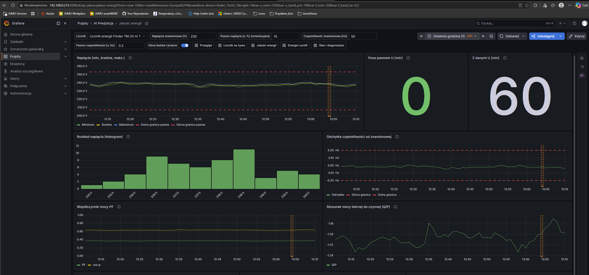
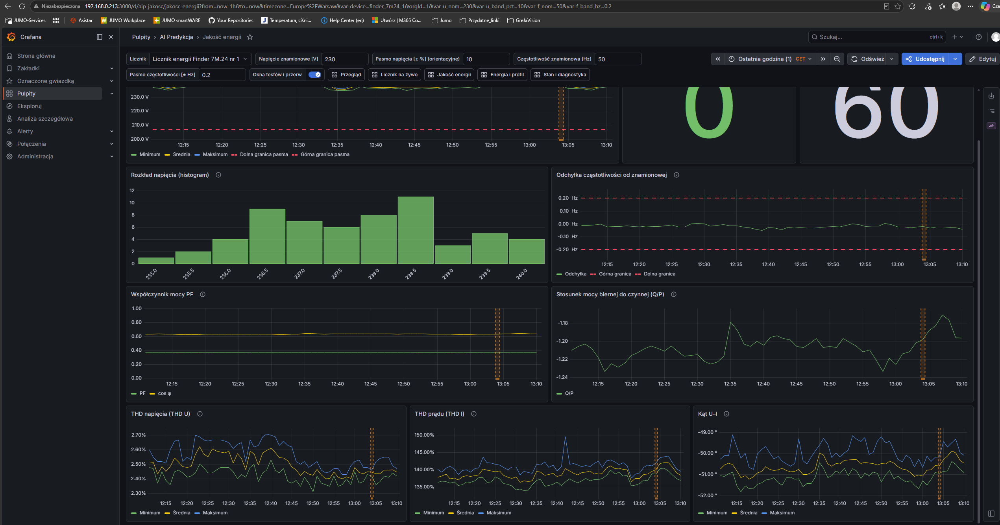

# Etap 2 – dane z PLC do bazy i Grafany: lokalny stos na komputerze przemysłowym

Stan: **SZKIC (część A k8, 25.11.2026)** – pozycje oznaczone „część B” uzupełni raport `e2-k8b-report.md` po 26.11. Etap zostaje zamknięty dopiero po akceptacji tej checklisty przez Grzegorza; etap 3 nie rusza wcześniej.
Kontrakt z PLC: [`docs/modbus-map.md`](../modbus-map.md) (v1 i v2; od 25.11.2026 10:43 UTC aktywna v2). Model danych: [`docs/data-model.md`](../data-model.md), kody statusu: [`docs/status-codes.md`](../status-codes.md), Grafana: [`docs/grafana.md`](../grafana.md), eksploatacja: [`docs/ops/jumo-ipc-setup.md`](../ops/jumo-ipc-setup.md).

## Co powstało

PLC (Modbus TCP, tylko FC04) → `collector` → Mosquitto → `ingest` → TimescaleDB → Grafana (5 dashboardów). Wszystko w Docker Compose na komputerze `jumo-ipc`, bez internetu; każdy kontener ma `mem_limit`. Migracje 001–011 wbudowane w obraz `migrate`.
Wiersze na sekundę (mapa v2): **20** przy statusie licznika 0 (13 + 7), **5** przy `meter_status ≠ 0`, **1** przy PLC offline.

## Konwencje

Polecenia wykonujesz z laptopa w cmd jako `ssh jumo@192.168.0.213 "<polecenie>"`. Zapytania SQL: `docker exec aip-timescaledb psql -U postgres -d energy -c "<SQL>"` (bez hasła, przez gniazdo w kontenerze; bez dotykania `.env`).

## Checklista akceptacji

| # | Krok (polecenie) | Oczekiwane | Stan |
| --- | --- | --- | --- |
| 1 | `docker compose -f ai-predykcja/docker-compose.yml ps` | `aip-mosquitto`, `aip-timescaledb`, `aip-ingest`, `aip-collector`, `aip-grafana` = Up (healthy); `aip-migrate` = Exited (0) | OK (25.11): 5 × Up (healthy); `ps` bez `-a` nie pokazuje zakończonego `aip-migrate` – zgodnie z oczekiwaniem |
| 2 | `docker stats --no-stream` | każdy kontener poniżej swojego limitu (część B: pomiar po dobie, szczyt ≤ 80 % limitu) | OK wstępnie (26.11, 17 h 47 min): 0 OOM; szczyt Grafany 76,7 % (harness 25.11 13:12), w zwykłej pracy maks. 62,6 %; pełna doba – uzupełnienie po 13:00 |
| 3 | `ss -ltn` | z nowych portów tylko 1883 (127.0.0.1) i 3000; 80/443 zajęte przez smartWARE; baza bez portu na hoście | OK (25.11): 1883 tylko 127.0.0.1, 3000; 5432 bez portu na hoście |
| 4 | `psql … -c "SELECT version, name FROM schema_migrations ORDER BY 1"` | 11 wierszy (001–011) | OK (25.11): 11 migracji 001–011 |
| 5 | `git ls-files \| findstr /i ".env"` w repo na laptopie | tylko `.env.example`; sekretów w repo brak | OK (25.11): tylko `.env.example` |
| 6 | `mbpoll -m tcp -a 1 -t 3:float -B -0 -r 16 -c 9 -1 192.168.0.246` i w tej samej chwili ostatni wiersz w bazie (`SELECT metric, value FROM measurements WHERE time > now() - interval '5 s' ORDER BY time DESC LIMIT 12`) | U zgodne ±0,5 V, P ±0,2 W; mapa rejestrów jak w `modbus-map.md` | OK (25.11): U 238,7 / 238,9 V (0,2 V), P 7 / 7,1 W (0,1 W) |
| 7 | `psql … -c "SELECT n, count(*) FROM (SELECT time_bucket('1 s', time) s, count(*) n FROM measurements WHERE time > now() - interval '10 minutes' AND time < now() - interval '10 s' GROUP BY 1) t GROUP BY n ORDER BY 2 DESC"` | prawie wszystkie sekundy mają **20** wierszy; wyjątki tylko w opisanych oknach | OK (25.11): 590 z 590 s po 20 wierszy |
| 8 | Grafana `http://192.168.0.213:3000` → 5 dashboardów (Przegląd, Na żywo, Jakość, Energia, Diagnostyka) | wykresy odświeżają się na żywo, brak „No data” i błędów w panelach; wartości zgodne z punktem 6 | OK (25.11): zrzuty 03–07b po k8c |
| 9 | Dashboard „Energia”: zakres „Ostatnie 24 godziny” oraz kontrola dobowa | energia z agregatów zgodna z różnicą liczników (`energy_daily_check`) w granicach rozdzielczości licznika (0,1 kWh) | OK (25.11): 24.11 i 25.11 `within_resolution = t`; 23.11 – 17 min danych, bez kroku licznika |
| 10 | `psql … -c "SELECT kind, start_time, end_time FROM data_windows ORDER BY start_time"` | 14 okien (w tym trzy `plc_program_download` i `ipc_reboot` z testu restartu) | OK (25.11): 14 okien |
| 11 | Grafana, dashboard „Jakość”, zakres obejmujący 24.11 14:25 UTC (UTC+0; w Grafanie 15:25 czasu lokalnego) | adnotacja „Download programu PLC” widoczna na wykresie | OK (25.11): okno `plc_program_download` 14:25:03–14:25:20 UTC zwracane przez zapytanie adnotacji dashboardu |
| 12 | Reguła „do PLC nie piszemy”: wynik testu `tests/collector/test_no_write.py` (w raporcie z pełnych testów) | wszystkie testy tego pliku zaliczone: interfejs klienta ma tylko `read_input_registers`, źródła bez funkcji zapisu, tylko FC04 | OK (26.11): w pełnym zestawie 507 passed, 0 failed |
| 13 | Pełne testy: `ssh jumo@192.168.0.213 "cd ai-predykcja && sh tests/run-tests.sh </dev/null"` (ok. 10 min) | brak błędów; 3 testy wydajnościowe pominięte (osobno `tests/run-perf.sh`) | OK (26.11): 507 passed, 3 skipped (wydajnościowe), 0 failed, 689,7 s |
| 14 | **Restart komputera** (`sudo reboot`; wykonany 25.11.2026, wynik w `e2-k8a-report.md`, sekcja 10: luka 37 s, wszystko wstało samo) | wszystkie usługi wstają same, bez `docker compose up`; do pierwszego nowego punktu na wykresie < 5 min; `aip-migrate` nie biegnie ponownie | OK (25.11): luka 37 s, wszystko wstało samo |
| 15 | Kompresja i rozmiar bazy (**część B**, po 26.11 00:00 UTC) | liczby B/wiersz, MB/dobę, prognoza 90 dni i roku agregatów w `e2-k8b-report.md` | OK (26.11): chunk 24.11 – kompresja 43× (196,4 → 4,53 B/wiersz, mapa v1); prognoza ok. 7,8 MB/dobę, ok. 1,5 GB na 90 dni; pomiar v2 – 28.11 |
| 16 | Konto czatu/Grafany tylko do odczytu: `psql` jako `app_reader` odrzuca `INSERT` | błąd „permission denied” (test `tests/db/test_roles.py`) | OK (26.11): w pełnym zestawie 507 passed, 0 failed |

Polecenia checklisty wykonał Claude Code na decyzję Grzegorza (25.11.2026); wyniki ocenili Grzegorz i architekt na podstawie surowych wydruków w e2-checklista-wyniki.md.

Stany błędów (RS485 odłączony, PLC offline, zatrzymanie programu) **nie są powtarzane** – wykonane i opisane w `docs/handoff/e2-k5-report.md` (sekcje 6–8: liczby, okna, zachowanie `link_status`). Za k5 stoi też decyzja z 24.11, by nie wykonywać ich ponownie.
*Opcjonalnie, jeśli chcesz powtórzyć:* odłącz na 10 s jeden przewód RS485 przy złączu „COM”; oczekiwane: `meter_status ≠ 0`, w bazie 5 wierszy na sekundę (zapytanie jak w pkt 7), po podłączeniu powrót do 20.

## Zrzuty ekranu (docs/images/etap2)

01–09 wykonane, a po teście restartu (25.11.2026):

Adnotacja `ipc_reboot` (pomarańczowy pas ok. 13:04) widoczna na wszystkich wykresach; luka trwa 37 s, więc na wykresach minutowych brak przerwy (kafelek „Z danymi U [min]” = 60 z 60 minut).

Metryki mapy v2 (THD, kąt, PF, cos φ) liczone po restarcie bez zmian: PF ≈ 0,37, cos φ ≈ 0,63, kąt ok. −50°. Stany błędów 20–29 nie zostały powtórzone w k8; są w dokumentacji z k5 (opisy i liczby), a brakujące zrzuty można dosłać opcjonalnie (nazewnictwo wg dokumentu 04).

## Znane ograniczenia (nie blokują zamknięcia etapu 2)

- **E2-PLC1:** błędy CRC na RS485 pojawiają się seriami; przyczyna fizyczna nieustalona, odłożone (nie wpływa na zgodność wartości; w bazie widoczne jako `meter_status ≠ 0`).
  Fakty z 25.11.2026 (k8c): 36 epizodów `meter_status ≠ 0` od północy, **wszystkie przy mapie v1**, w trzech seriach co 128 s (00:24–00:49, jeden o 00:56 i 08:23–09:09 czasu lokalnego), każdy ok. 4 s, kody 162 (123 wiersze) i 161 (20 wierszy); po 09:10 lokalnie żadnego; pod mapą v2 do ok. 14:47 lokalnie zero. **Korekta 26.11 (e2-k8b-report.md):** od 25.11 14:41 UTC epizody wróciły także pod mapą v2 – 57 do rana 26.11 (14–17 UTC: 40, 22–24 UTC: 17), każdy ok. 5 s, odstępy wielokrotnością 64 s. Mapa v2 nie usuwa błędu; przyczyna fizyczna (RS485) nadal do diagnozy.
- **Drugi licznik** wymaga nowej mapy Modbus (większe `awTcpInputRegs`, np. rejestry 0–199 – nowa wersja mapy), zgłoszone architektowi na etap 3.
- **`energy_1m_calc` i `reactive_1h_calc`** są wolne na rocznych zakresach (widoki; panele czytają agregaty bezpośrednio) – przepisanie na funkcje zakresowe w etapie 4.
- Taryfy i koszty energii nie należą do etapu 2 (etap 4); dashboardy ich nie zawierają.
- Grafana była zabijana przez OOM-killera przy limicie 384 MiB (24.11 dwa razy, 25.11 raz); od k8a limit 512 MiB + `GOMEMLIMIT=400MiB`. Rozstrzygnięcie po dobie pomiaru (część B: `memory.peak`, `oom_kill` = 0).
- Zegar komputera w strefie Europe/Berlin (smartWARE), baza w UTC, Grafana pokazuje Europe/Warsaw.

## Warunek zamknięcia

Wszystkie pozycje checklisty „OK” (pozycje 14 i 15 po testach z k8), a Ty zaznaczasz akceptację. Dopiero wtedy etap 3.
